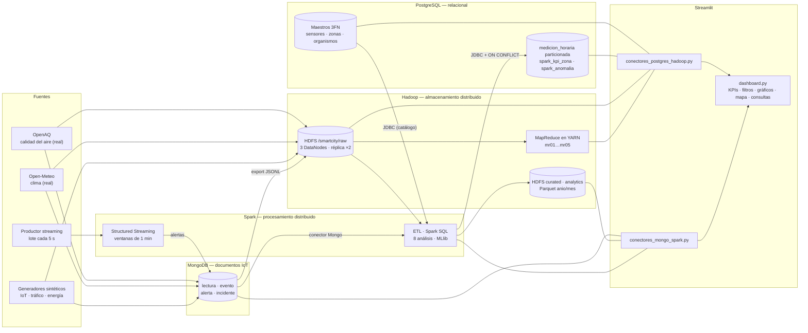

# Arquitectura — SmartCity Analytics

Cuatro motores, cada uno en el rol que mejor cumple (ver [04_justificacion_tecnologica.md](../tecnico/04_justificacion_tecnologica.md)).
El dashboard no contiene SQL ni pipelines: solo importa los dos módulos de conectores.

PNG (para el documento impreso): `docs/diagramas/img/arquitectura.png`, generado con `python scripts/exportar_diagramas.py`.

| Capa | Tecnología | Rol | Datos |
|---|---|---|---|
| Ingesta | Scripts Python | Descarga idempotente y generación reproducible (semilla 2026) | `data/raw/`, `data/interim/` |
| Operacional documental | MongoDB 7 | Lecturas con esquema variable, eventos, alertas, incidentes | ~1,07 M documentos |
| Almacenamiento masivo | HDFS 3.2.1 | Crudos inmutables, exports, Parquet curado, salidas MapReduce | réplica ×2 en 3 nodos |
| Procesamiento batch | MapReduce (YARN) y Spark 3.5 | Conteos masivos; ETL, SQL, análisis, ML | 4,38 M filas en formato largo |
| Procesamiento continuo | Spark Structured Streaming | Alertas por umbral en ventanas de 1 min | lotes de HDFS → Mongo |
| Relacional | PostgreSQL 16 | Maestros con integridad, mediciones limpias, resultados de Spark | `medicion_horaria` ≥ 175k filas |
| Presentación | Streamlit | Vista única con KPIs de 4 grupos, consultas por tecnología, comparación | — |
