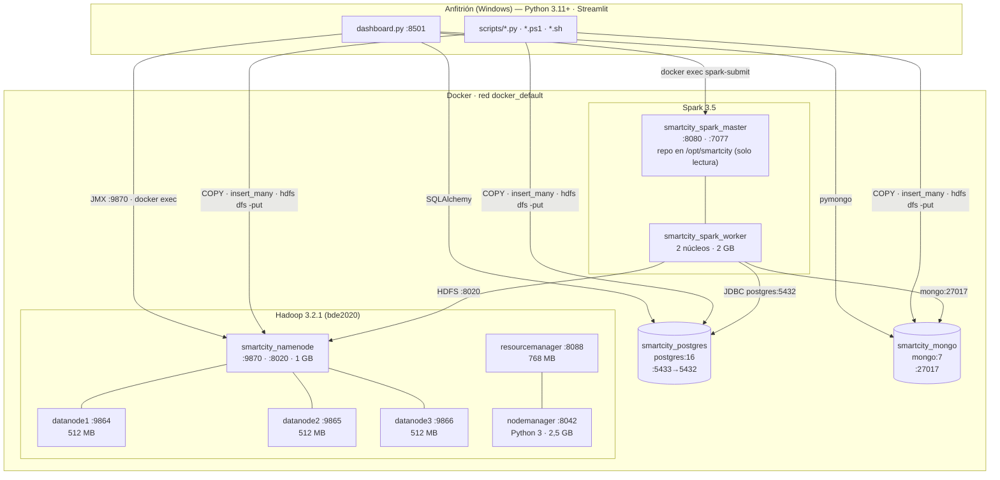

# Despliegue en Docker

Un solo `docker compose` levanta los 10 contenedores en la red por defecto del proyecto (`docker_default`). El dashboard y los scripts corren en
Windows y llegan a los servicios por los puertos publicados; los jobs Spark corren **dentro** del master (D-04).

PNG (para el documento impreso): `docs/diagramas/img/despliegue_docker.png`, generado con `python scripts/exportar_diagramas.py`.

| Contenedor | Imagen | Puertos (anfitrión) | Memoria |
|---|---|---|---|
| smartcity_postgres | `postgres:16` | 5433 → 5432 | sin límite |
| smartcity_mongo | `mongo:7` | 27017 | sin límite |
| smartcity_namenode | `bde2020/hadoop-namenode:2.0.0-hadoop3.2.1-java8` | 9870, 8020 | 1 GB |
| smartcity_datanode1…3 | `bde2020/hadoop-datanode:…` | 9864, 9865, 9866 | 512 MB c/u |
| smartcity_resourcemanager | `bde2020/hadoop-resourcemanager:…` | 8088 | 768 MB |
| smartcity_nodemanager | `smartcity-hadoop-nodemanager:3.2.1` (bde2020 + Python 3) | 8042 | 2,5 GB |
| smartcity_spark_master | `bitnamilegacy/spark:3.5` (o `smartcity-spark-ml:3.5`) | 8080, 7077 | sin límite |
| smartcity_spark_worker | ídem | — | 2 GB para ejecutores, 2 núcleos |

El puerto 5433 se eligió porque el 5432 del anfitrión lo ocupa un PostgreSQL instalado en Windows. Los límites de
memoria permiten levantar todo con ~8 GB libres para Docker.
