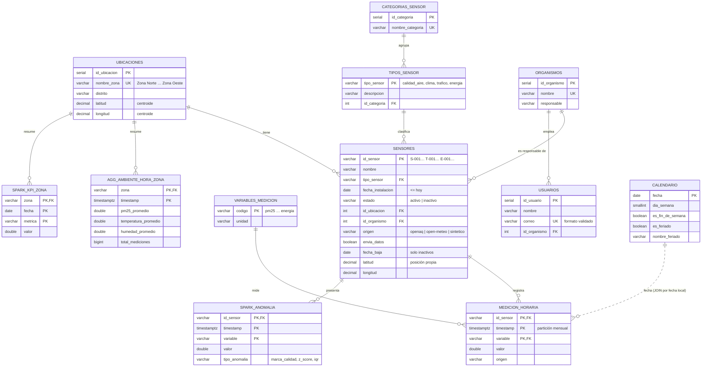

# Diagrama entidad-relación — PostgreSQL (`smartcity_db`)

Las cinco entidades mínimas del enunciado (en negrita en la tabla de abajo) más las tablas que exige la 3FN y las del flujo de datos. DDL: [sql/ddl/](../../sql/ddl/) (ejecutar con `python scripts/pg_init.py`).

| Tabla | Tipo | Origen de los datos |
|---|---|---|
| **ubicaciones** | maestra (entidad mínima) | `config/zonas.yaml` |
| **categorias_sensor** | maestra (entidad mínima) | DDL |
| tipos_sensor | maestra (3FN) | DDL |
| **organismos** | maestra (entidad mínima) | `data/maestros/sensores.csv` + 2 sin sensores |
| **sensores** | maestra (entidad mínima) | `data/maestros/sensores.csv` + contadores T-00x y medidores E-00x |
| **usuarios** | maestra (entidad mínima) | 40 ficticios (`scripts/pg_cargar_maestros.py`) |
| variables_medicion, calendario | referencia | DDL |
| medicion_horaria | hechos (particionada por mes) | Spark B3.4 (`spark/jobs/carga_pg.py`) |
| agg_ambiente_hora_zona, spark_kpi_zona, spark_anomalia | resultados de Spark | Spark B3.4 |
| benchmark_resultado | experimentos | `scripts/pg_optimizacion.py` y C1 |

Objetos derivados: vista `v_sensor_detalle`; vistas materializadas `mv_actividad_sensor` y `mv_kpi_diario_zona`; funciones `fn_sensores_por_organismo`, `fn_sensores_sin_actividad`, `fn_kpi_ambiente` y `fn_crear_particiones`; procedimiento `sp_refrescar_mv`.
