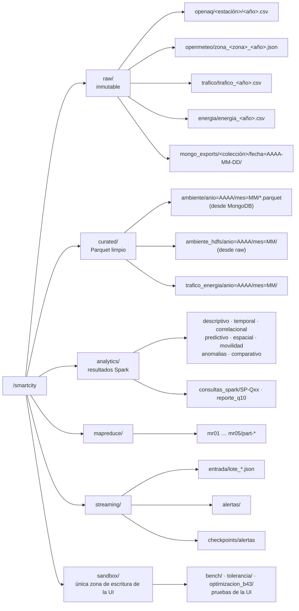

# Estructura de HDFS

Creada con [hadoop/hdfs/01_estructura.sh](../../hadoop/hdfs/01_estructura.sh); la justificación está en
[07_estrategia_big_data.md](../tecnico/07_estrategia_big_data.md) §7.2.

PNG (para el documento impreso): `docs/diagramas/img/estructura_hdfs.png`, generado con `python scripts/exportar_diagramas.py`.

| Decisión | Motivo |
|---|---|
| Capas `raw → curated → analytics` | Se reprocesa desde `raw` si cambia una regla, sin volver a descargar |
| Un archivo por estación/zona y **año** | Evita el problema de archivos pequeños: el NameNode guarda ~150 bytes de metadata por archivo y bloque en memoria |
| Particiones `anio=/mes=` y `fecha=` | *Partition pruning*: Spark y MapReduce leen solo las carpetas que piden |
| CSV/JSON sin gzip en `raw` | gzip no es divisible: un archivo comprimido lo procesaría una sola tarea |
| Parquet + Snappy en `curated` | Columnar, divisible y comprimido (en E0 el Parquet ocupa ~6 % del CSV) |
| `dfs.replication = 2` en 3 DataNodes | Un nodo puede caer sin perder datos ni disponibilidad (E6). Spark escribe con la misma réplica (`get_spark()`) |
| Escritura de la UI solo en `sandbox/` | La interfaz no puede borrar datos de las demás capas (`conectores_postgres_hadoop.hdfs_rm`) |

Las rutas de Spark están en `spark/jobs/rutas.py`: los ETL escriben en `/smartcity/curated/` (`ambiente`, `ambiente_hdfs`, `trafico_energia`) y los análisis y consultas en `/smartcity/analytics/`; `sandbox/` queda para pruebas, benchmarks y el experimento B4.3.
