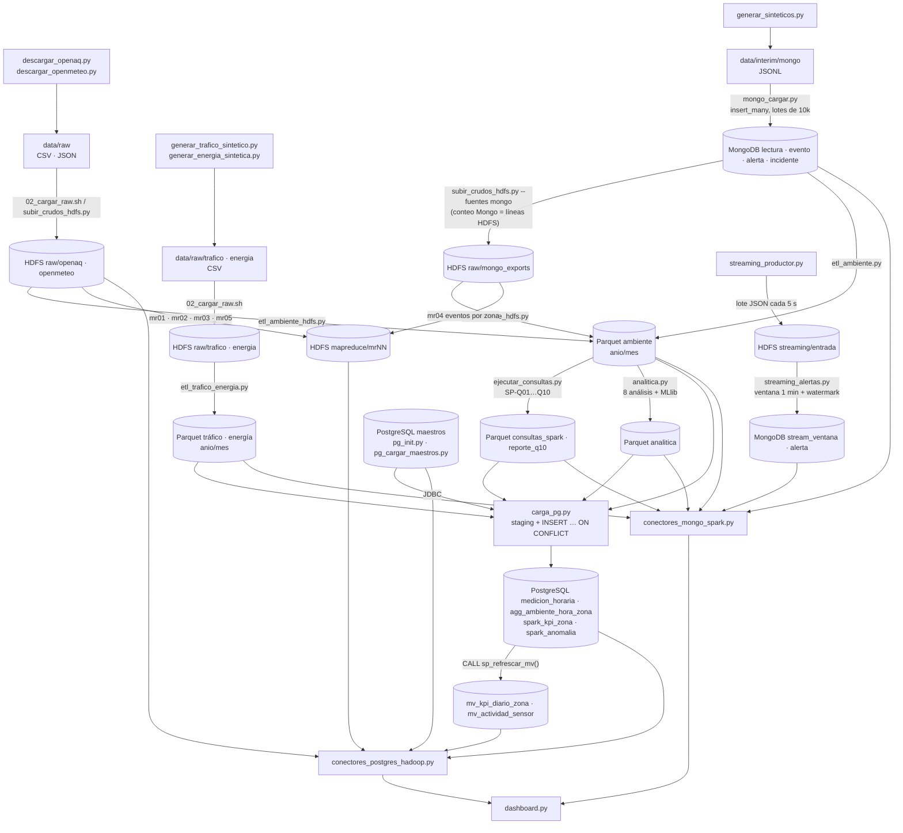

# Flujo de datos entre las cuatro tecnologías

Recorrido de un dato desde que se descarga o genera hasta que aparece en el dashboard. Cada flecha indica el script o
job que la implementa.

PNG (para el documento impreso): `docs/diagramas/img/flujo_datos.png`, generado con `python scripts/exportar_diagramas.py`.

**Integraciones que pide el enunciado** (objetivo específico 5):

1. *Datos de sensores → MongoDB → HDFS → Spark*: `mongo_cargar.py` → `subir_crudos_hdfs.py --fuentes mongo` →
   `etl_ambiente_hdfs.py`.
2. *Datos limpios de Spark → PostgreSQL*: `carga_pg.py` (idempotente: volver a ejecutarlo no duplica filas).
3. *Catálogo de PostgreSQL → Spark*: `carga_pg.py` y `benchmark_spark.py` leen sensores, tipos, categorías y
   organismos por JDBC.
4. *Streaming → MongoDB*: las alertas del job de streaming entran en la misma colección `alerta` que las del
   procesamiento batch, con `origen = "streaming"`.
