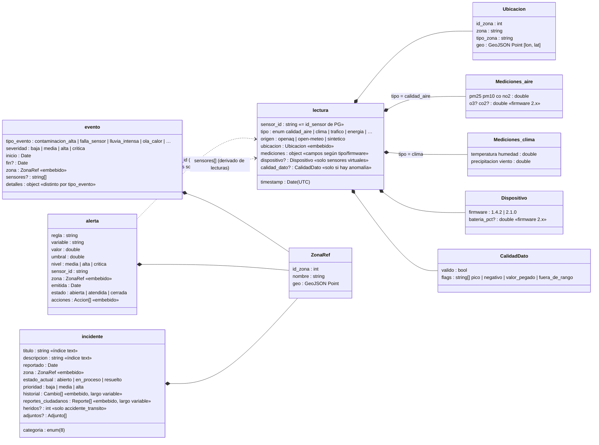

# Modelo documental — MongoDB (`smartcity_db`)

Diagrama de las cuatro colecciones principales y de las referencias lógicas entre ellas. Las líneas punteadas son **referencias por valor** (`sensor_id`, `zona.nombre`), no claves foráneas: MongoDB no las hace cumplir. La integridad del catálogo de sensores y zonas la garantiza PostgreSQL.

## Colecciones auxiliares

| Colección | Uso | Validador |
|---|---|---|
| `demo_crud` | Demostración CRUD desde la UI (B2.3); nunca se toca `lectura` | No |
| `lectura_tmp` | Ejemplo de índice TTL (`creado`, expira a la hora) | No |

## Índices

| Colección | Índice | Para qué |
|---|---|---|
| `lectura` | `{sensor_id: 1, timestamp: -1}` | MG-Q01 (últimas lecturas de un sensor) |
| `lectura` | `{tipo: 1, "ubicacion.zona": 1, timestamp: -1}` | MG-Q02/Q06/Q07 y filtros del dashboard |
| `lectura` | `{timestamp: 1}` | Rangos de fechas y exportación |
| `lectura` | `{"ubicacion.geo": "2dsphere"}` | Consultas geoespaciales |
| `evento` | `{tipo_evento: 1, severidad: 1, inicio: -1}` | MG-Q04 |
| `evento`, `alerta` | `{"zona.geo": "2dsphere"}` | `$geoNear` (MG-Q05 con radio) |
| `alerta` | `{"zona.nombre": 1, emitida: -1}` | MG-Q05 |
| `alerta` | `{estado: 1}` parcial (`estado: "abierta"`) | Alertas abiertas; índice pequeño |
| `incidente` | `{categoria: 1, reportado: -1}` | MG-Q08 |
| `incidente` | `text` en `titulo` (peso 3) y `descripcion`, idioma español | Búsqueda de texto libre |
| `lectura_tmp` | `{creado: 1}` TTL 3600 s | Datos temporales que se borran solos |

Definición: [mongo/01_colecciones.js](../../mongo/01_colecciones.js), [mongo/02_indices.js](../../mongo/02_indices.js) y su equivalente en Python, [scripts/mongo_admin.py](../../scripts/mongo_admin.py).
