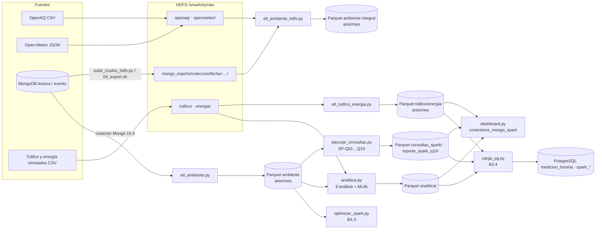

# 8. Procesamiento distribuido (Apache Spark)

## 8.1 Flujo



Las rutas HDFS están centralizadas en [spark/jobs/rutas.py](../../spark/jobs/rutas.py): los ETL escriben en `/smartcity/curated/` (`ambiente`, `ambiente_hdfs`, `trafico_energia`) y los análisis y consultas en `/smartcity/analytics/`; `sandbox/` queda para pruebas, benchmarks y el experimento B4.3. Todos los jobs crean la sesión con `get_spark()` ([common.py](../../spark/jobs/common.py)), que fija `dfs.replication = 2` como el resto del clúster (D-05).

## 8.2 Ejecución (D-04)

Los jobs se ejecutan con `spark-submit` **dentro** de `smartcity_spark_master` (repositorio montado en `/opt/smartcity`, solo lectura) contra `spark://spark-master:7077`:

```powershell
.\scripts\spark_submit.ps1 <job> [argumentos]      # p. ej.: .\scripts\spark_submit.ps1 analitica --analisis anomalias
```

`spark/jobs/common.py` define `get_spark()` (zona horaria UTC, `fs.defaultFS=hdfs://namenode:8020`, 8 particiones de *shuffle*), las rutas y `leer_mongo()` (esquema explícito + *pipeline* empujado a Mongo). Correr el driver desde Windows falla por red y por la versión de Python; por eso el dashboard **no** crea una SparkSession: lee los Parquet resultantes y relanza jobs con `docker exec` (botón «Recalcular»).

## 8.3 Jobs: entrada → transformaciones → salida

| Job | Entrada | Transformaciones principales | Salida |
|---|---|---|---|
| `etl_ambiente.py` (B3.2) | Mongo `lectura` (1.068.584 docs) | Esquema explícito (`StructType`); `explode` de `mediciones` a formato largo; filtros de zona, nulos, NaN, rango por variable (temperatura −60…60, humedad 0…100, resto ≥ 0) y `calidad_dato.valido`; `dropDuplicates(id_sensor, timestamp, tipo_metrica)` | Parquet `anio/mes`, 4.380.538 filas |
| `etl_ambiente_hdfs.py` (B3.2) | Crudos OpenAQ/Open-Meteo + export JSONL de Mongo en HDFS | Mismas reglas; catálogo de sensores en *broadcast* (integridad referencial sensor-zona); deduplicación con `row_number()` que prioriza el dato crudo externo sobre la réplica en Mongo | Parquet `anio/mes` (exige ≥ 1 M filas) |
| `etl_trafico_energia.py` (B3.3) | `raw/trafico`, `raw/energia` (simulados) | Esquema explícito; validación de rangos; formato largo del contrato (`tipo_metrica` = trafico \| energia) | Parquet `anio/mes` |
| `ejecutar_consultas.py` (B4.1) | Parquet curado (+ Mongo para SP-Q02/Q07) | 10 consultas Spark SQL sobre vistas temporales: `GROUP BY`, JOIN, `date_trunc`, `corr()`, `RANK()`, `LAG()`, z-score con ventanas, `ROLLUP/CUBE`, `PIVOT` | Resultado de cada consulta en `consultas_spark/<ID>`; SP-Q10 en `reporte_spark_q10` |
| `analitica.py` (B4.2) | Parquet curado (+ Mongo para anomalías, + tráfico para movilidad) | 8 análisis con la API DataFrame: descriptivo, temporal, correlacional, predictivo (MLlib `LinearRegression`, 2023 entrenamiento / 2024 prueba, comparado con una línea base), espacial, movilidad (proxy pico/valle + tráfico simulado), anomalías (marcas + z-score + IQR), comparativo | `analitica/<salida>` |
| `optimizar_spark.py` (B4.3) | Parquet curado | Pares de consultas equivalentes (ver [spark_optimizacion.md](../resultados/spark_optimizacion.md)) | `optimizacion_b43/` |

Resultados e interpretación: [docs/resultados/hallazgos_spark.md](../resultados/hallazgos_spark.md).

## 8.4 Transformaciones, acciones y evaluación perezosa

En Spark, `filter`, `select`, `withColumn`, `join`, `groupBy().agg()` y `explode` son **transformaciones**: no ejecutan nada, solo agregan pasos al plan lógico. El trabajo ocurre recién con una **acción**: `count()`, `collect()`, `show()` o `write.parquet()`. Por ejemplo, en `etl_ambiente.py`:

1. `spark.read.format("mongodb")…load()` define la fuente; no lee documentos todavía.
2. `transformar(df)` encadena `select → explode → filter → dropDuplicates → withColumn`: el plan crece y no se mueve un solo dato.
3. `write.partitionBy("anio","mes").parquet(...)` es la acción. Catalyst optimiza el plan completo (empuja los filtros hacia la fuente y poda columnas) y recién entonces lanza las tareas en los workers.
4. `spark.read.parquet(salida).count()` es una segunda acción: relee lo escrito para verificar el conteo.

Ventajas: Catalyst ve el plan completo antes de ejecutar; los pasos intermedios no se materializan; y cuando un resultado se reutiliza se pide caché explícita (`persist`, como en el predictivo y en B4.3), sabiendo que la materialización tiene un costo.

## 8.5 Particionamiento

- **En disco:** los Parquet se escriben con `partitionBy("anio", "mes")` (24 particiones para 2023–2024). Un filtro sobre `anio`/`mes` lee solo esas carpetas (*partition pruning*, B4.3). Se eligió mes y no día para no generar miles de archivos pequeños, un problema conocido de HDFS porque el NameNode guarda en memoria la metadata de cada archivo.
- **En memoria:** `spark.sql.shuffle.partitions=8`, acorde a 2 *cores*. El valor por defecto de 200 generaría 200 tareas casi vacías por cada *shuffle*. AQE (Spark 3.5) además une particiones pequeñas en tiempo de ejecución.
- **Joins:** los catálogos pequeños (sensores, zonas, estadísticas por sensor) se envían en *broadcast* a cada ejecutor para evitar el *shuffle* del lado grande.

## 8.6 Streaming (reto adicional): Spark Structured Streaming

[spark/jobs/streaming_alertas.py](../../spark/jobs/streaming_alertas.py) procesa la llegada **continua** de lecturas que simula `scripts/streaming_productor.py`:

```
productor --(cada 5 s: lote JSON)--> HDFS /smartcity/streaming/entrada
   --> readStream (fuente de archivos, esquema explícito)
   --> withWatermark(timestamp, 2 min) + groupBy(window 1 min, zona): PM2.5 prom/máx, vehículos/h, lecturas
   --> foreachBatch cada 10 s: upsert en MongoDB stream_ventana + alertas (PM2.5 > 35,4 / vehículos > 1.200)
       en MongoDB `alerta` (origen = streaming) + histórico en HDFS /smartcity/streaming/alertas
```

| | Batch (B3/B4) | Streaming |
|---|---|---|
| Qué procesa | Todo el histórico (2 años), una vez | Solo lo que llegó desde el último micro-lote |
| Latencia | Minutos (relanzar el job) | Segundos: trigger de 10 s, ventanas de 1 min |
| Estado | Ninguno entre ejecuciones | Ventanas abiertas y archivos ya leídos, en el **checkpoint** de HDFS: si el job se reinicia, sigue sin duplicar |
| Tiempo | De procesamiento | **De evento** (`timestamp` de la lectura) con *watermark*: tolera lecturas hasta 2 min tarde y luego cierra la ventana |
| API | DataFrames / Spark SQL | **La misma** (`groupBy`, `window`, `avg`), sobre un DataFrame «infinito» |

Prueba realizada (2026-11-27): 14 lotes con episodio forzado en Zona Centro (PM2.5 ≈ 50–61 µg/m³). En 10 micro-lotes se procesaron 5 ventanas por lote y se generaron alertas **solo** para Zona Centro (56,1 → nivel alta, 55,3 → media). El upsert por `_id` = regla|zona|ventana evita duplicar la alerta cuando la misma ventana se actualiza en varios micro-lotes. En el dashboard: página «Streaming en vivo», que se refresca cada 5 s.

## 8.7 ¿Por qué Spark y no PostgreSQL para esto?

| Necesidad | PostgreSQL | Spark |
|---|---|---|
| ETL de 1 M documentos semiestructurados (Mongo) + CSV/JSON crudos en HDFS → formato largo de 4,4 M filas | Requiere cargar todo primero en tablas y luego transformar con SQL | Lee Mongo, CSV y JSON directamente, con esquema explícito, y escribe Parquet columnar en HDFS |
| Escalar con el volumen | Escala vertical (un servidor) | Escala horizontal: agregar workers sin cambiar el código (E5: 1 frente a 2 workers) |
| Análisis sobre todo el histórico (correlaciones entre 6 variables por zona, z-score e IQR por sensor, perfiles horarios) | Factible, pero cada consulta recorre tablas grandes en un solo proceso y compite con la carga operativa | Ejecución paralela en los workers sobre Parquet particionado; no carga la base operativa |
| Aprendizaje automático (regresión de PM2.5 diario según el clima) | Fuera del motor (exportar a Python) | MLlib en el mismo job y sobre los mismos datos |
| Consultas puntuales e integridad referencial | **Mejor**: índices B-tree/BRIN, FK, transacciones | Mala opción: arranque de un job por consulta y sin índices (E2) |

Conclusión: Spark se usa para el procesamiento **por lotes** de gran volumen y para el análisis; PostgreSQL, para el modelo relacional y las consultas operativas y puntuales. Los resultados agregados de Spark vuelven a PostgreSQL (B3.4, tablas `spark_*`) para que el dashboard y SQL los consulten rápido. Primera carga real: 175.440 filas de tráfico y energía en `medicion_horaria`, con conteo Spark = PostgreSQL.
